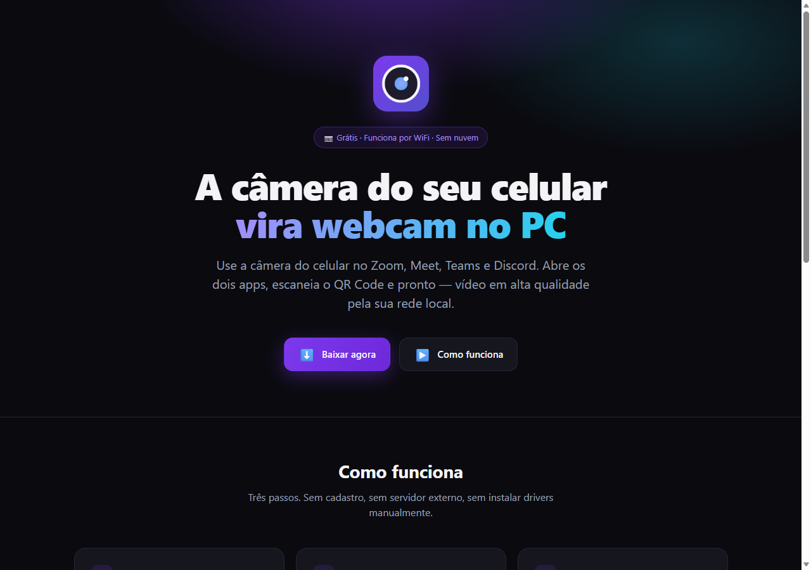
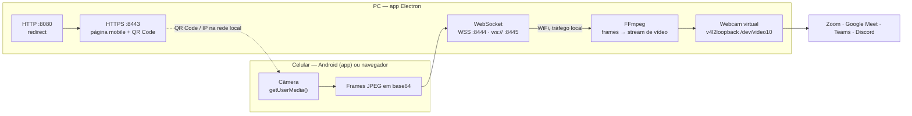

# Phone Webcam

[](https://github.com/in100tiva/webcam/releases/latest)
[](https://in100tiva.github.io/webcam/)
[](LICENSE)
[](https://github.com/in100tiva/webcam/actions/workflows/codeql.yml)
[](https://github.com/in100tiva/webcam/actions/workflows/ci.yml)


> **Em 30 segundos:** transforma o celular em webcam do PC pela WiFi. O app desktop recebe o vídeo por WebSocket e publica em uma webcam virtual que Meet, Zoom e Teams enxergam como câmera nativa.

<p align="center">
  <a href="https://in100tiva.github.io/webcam/">
    
  </a>
</p>

Use a câmera do seu celular como webcam no PC via WiFi usando Electron.js.

## ⬇️ Download

Baixe os instaladores na [página de Releases](https://github.com/in100tiva/webcam/releases/latest):

| Plataforma | Arquivo | Tamanho |
|---|---|---|
| 🐧 Linux (Ubuntu/Debian/Mint) | [`PhoneWebcam-linux.deb`](https://github.com/in100tiva/webcam/releases/latest/download/PhoneWebcam-linux.deb) — `sudo apt install ./PhoneWebcam-linux.deb` (configura a webcam virtual sozinho) | ~92 MB |
| 🐧 Linux (qualquer distro) | [`PhoneWebcam-linux.AppImage`](https://github.com/in100tiva/webcam/releases/latest/download/PhoneWebcam-linux.AppImage) — `chmod +x` e execute | ~134 MB |
| 🪟 Windows 10/11 (64-bit) | [`PhoneWebcam-windows.exe`](https://github.com/in100tiva/webcam/releases/latest/download/PhoneWebcam-windows.exe) — instalador NSIS; use junto com o **OBS Virtual Camera** | ~97 MB |
| 🤖 Android (celular) | [`PhoneWebcam-android.apk`](https://github.com/in100tiva/webcam/releases/latest/download/PhoneWebcam-android.apk) | ~3,8 MB |

A [landing page](https://in100tiva.github.io/webcam/) mostra os mesmos downloads
em uma página única. Ela fica em `site/` e é publicada no GitHub Pages por
`.github/workflows/pages.yml` a cada mudança na pasta. Os instaladores são
gerados pelo CI (`.github/workflows/release.yml`) quando uma tag `v*` é enviada.

📘 O passo a passo de instalação por plataforma (o que o `.deb` configura, como
gerar `.apk`/`.AppImage` e as portas de rede) está em
**[DISTRIBUICAO.md](DISTRIBUICAO.md)**.

> Instaladores não têm assinatura comercial: o Windows pode exibir o aviso do
> SmartScreen e o `apt` pode reclamar da origem. Confira o nome do arquivo e
> baixe apenas da página oficial de Releases.

## Funcionalidades

- 📹 Streaming de vídeo em tempo real via WebSocket (SSL)
- 📱 QR Code para conexão fácil do celular
- 🔄 Trocar entre câmera frontal e traseira
- ⚡ Controle de flash/lanterna
- 📊 Ajuste de qualidade (480p, 720p, 1080p)
- 📸 Captura de screenshots
- ↔️ Modo espelhado
- 🔃 Rotação de vídeo (0°, 90°, 180°, 270°)
- 📐 Ajuste de proporção (16:9, 4:3, 1:1, 9:16)
- ⛶ Tela cheia
- 🎥 **Webcam Virtual** - Use em Zoom, Meet, Teams, etc.

## Webcam Virtual (Google Meet, Zoom, Teams)

O Phone Webcam expõe a câmera do celular como uma **webcam de verdade** do
sistema operacional — é assim que o Meet/Zoom/Teams conseguem enxergá-la.

### Linux (Ubuntu / Debian / Mint) — passo a passo

O device virtual chama-se **"Phone Webcam"** (`/dev/video10`) e é criado pelo
driver `v4l2loopback`.

1. **Instale pelo `.deb`** — ele já configura o `v4l2loopback` sozinho no
   `apt install` (módulo, carga no boot, permissão do device). Se você roda do
   código-fonte, faça o mesmo setup com `npm run setup:linux` (uma vez só).
2. Abra o Phone Webcam e conecte o celular pelo QR Code.
3. Clique em **"Iniciar Webcam Virtual"**.
4. Abra o Google Meet (ou Zoom/Teams) **e dê F5** — o Chrome só enumera
   câmeras novas ao recarregar a página.
5. Em Configurações → Vídeo, selecione **"Phone Webcam"**.

> **Por que `exclusive_caps=1`:** sem essa opção do módulo o Chrome **ignora**
> o device (o Firefox aceita). O setup automático já aplica.

> Se o device travar, o app se recupera sozinho: ele recarrega o módulo pedindo
> a senha numa janela gráfica (PolicyKit/`pkexec`). Você não precisa de terminal.

### Windows / macOS

| Plataforma | Driver | Como instalar |
|------------|--------|---------------|
| Windows | OBS Virtual Camera | Instale o [OBS Studio](https://obsproject.com) |
| macOS | OBS Virtual Camera | Instale o [OBS Studio](https://obsproject.com) |

Conecte o celular, clique em "Iniciar Webcam Virtual" e selecione
**"OBS Virtual Camera"** como fonte de vídeo no app de chamada.

## Requisitos

- Node.js 18+
- NPM ou Yarn
- PC e celular conectados na mesma rede WiFi

## Instalação

### Desenvolvimento

```bash
# Clone o repositório
git clone <repo-url>
cd webcam

# Instale as dependências
npm install

# Linux: configure a webcam virtual (uma vez só — pede sudo)
npm run setup:linux

# Execute o aplicativo
npm start
```

> `npm run setup:linux` faz exatamente o que o `.deb` faz no `apt install`:
> instala o `v4l2loopback-dkms`, grava as opções do módulo
> (`exclusive_caps=1`, `video_nr=10`, label "Phone Webcam"), carrega no boot e
> deixa o `/dev/video10` gravável. Sem isso o Meet não tem o que listar.

### Build do Instalador

```bash
# Windows
npm run build:win

# macOS
npm run build:mac

# Linux
npm run build:linux
```

O instalador será criado na pasta `dist/`.

## Como Usar

### No PC

1. Execute o aplicativo com `npm start`
2. A janela do Phone Webcam será aberta
3. Um QR Code será exibido na tela

### No Celular

1. Conecte o celular na mesma rede WiFi do PC
2. Abra a câmera do celular e escaneie o QR Code
3. **Importante**: Aceite o certificado SSL clicando em "Avançado" > "Continuar"
4. Permita o acesso à câmera quando solicitado
5. O streaming começará automaticamente

## Controles

### Atalhos de Teclado

| Tecla | Ação |
|-------|------|
| `F` | Tela cheia |
| `S` | Capturar foto |
| `M` | Espelhar vídeo |
| `R` | Rotacionar 90° |

### Interface

- **Qualidade**: Escolha entre 480p, 720p ou 1080p
- **Proporção**: Auto, 16:9, 4:3, 1:1, ou 9:16
- **Rotação**: 0°, 90°, 180°, 270°
- **Trocar Câmera**: Alterna entre frontal e traseira
- **Flash**: Liga/desliga a lanterna

## Estrutura do Projeto

```
webcam/
├── src/
│   ├── main.js          # Processo principal do Electron
│   ├── preload.js       # Bridge IPC segura
│   ├── virtualcam/      # Módulo de webcam virtual
│   │   └── index.js
│   ├── renderer/        # Interface do PC
│   │   ├── index.html
│   │   ├── styles.css
│   │   ├── renderer.js
│   │   └── clean.html   # Janela limpa para OBS
│   └── mobile/          # Página web para o celular
│       └── index.html
├── drivers/             # Drivers de webcam virtual
├── installer/           # Scripts do instalador
├── package.json
└── README.md
```

## Arquitetura



Todo o caminho acontece na **rede local**: o celular fala direto com o PC, sem
servidor intermediário e sem nuvem. O navegador usa `wss://` (8444) e o app
Android nativo usa `ws://` puro (8445).

## Portas Utilizadas

| Porta | Protocolo | Uso |
|------:|-----------|-----|
| 8080 | HTTP | Redireciona para HTTPS (não é fatal se estiver ocupada) |
| 8443 | HTTPS | Serve a página mobile (QR Code) e a API de status |
| 8444 | WebSocket + SSL | Streaming de vídeo para o navegador |
| 8445 | WebSocket puro | Streaming de vídeo para o app Android nativo |

## Solução de Problemas

### O celular não conecta

1. Verifique se ambos estão na mesma rede WiFi
2. Selecione a interface de rede correta no PC
3. Desative o "Isolamento de cliente" no roteador (se houver)
4. Verifique se o firewall permite conexões nas portas 8443 e 8444

### Certificado SSL não aceito

1. No celular, ao abrir a URL, clique em "Avançado"
2. Clique em "Continuar para o site" ou "Aceitar o risco"
3. A câmera só funciona em conexões seguras (HTTPS)

### Vídeo com lag

1. Reduza a qualidade do vídeo para 720p ou 480p
2. Use a rede WiFi de 5GHz se disponível
3. Aproxime o celular do roteador

### O Google Meet não lista a "Phone Webcam" (Linux)

1. Recarregue a aba do Meet (**F5**) — o Chrome só enumera câmeras novas no load
2. Confirme que o device existe: `ls -l /dev/video10` e
   `cat /sys/class/video4linux/video10/name` (deve dizer `Phone Webcam`)
3. Se não existir, rode o setup: `npm run setup:linux`
   (ou reinstale o `.deb`, que faz isso sozinho)
4. Confirme que clicou em **"Iniciar Webcam Virtual"** no app e que o celular
   já está conectado — o device só entrega imagem com frames chegando
5. Feche outros programas que estejam usando a câmera virtual (OBS, Cheese):
   com `exclusive_caps=1` só um produtor por vez escreve no device

### Webcam virtual não detectada (Windows/macOS)

1. Instale o OBS Studio para obter o OBS Virtual Camera
2. No OBS, vá em Ferramentas > Iniciar Câmera Virtual
3. Reinicie o Phone Webcam
4. O driver será detectado automaticamente

### Vídeo achatado/distorcido

1. Use a opção "Automático" na proporção
2. Ou selecione 9:16 se estiver com o celular na vertical

## Tecnologias

- **Electron** - Framework desktop
- **Express** - Servidor web
- **WebSocket (ws)** - Streaming em tempo real
- **FFmpeg** - Processamento de vídeo
- **QRCode** - Geração de QR codes
- **selfsigned** - Certificados SSL auto-assinados

## Limitações conhecidas

- **Sem autenticação:** o pareamento é por QR Code dentro da rede local. Quem
  estiver na mesma WiFi alcança as portas 8443/8444 — use em rede confiável.
  Detalhes em [SECURITY.md](SECURITY.md).
- **Instaladores sem assinatura comercial:** Windows SmartScreen e `apt` podem
  avisar sobre a origem.
- **Windows/macOS** dependem do OBS Virtual Camera instalado à parte; o `.deb`
  no Linux já configura tudo.

## Contribuindo

Sugestões e correções são bem-vindas: veja [CONTRIBUTING.md](CONTRIBUTING.md)
para o ambiente de desenvolvimento e os padrões do projeto. Dúvidas de
instalação vão nas [Discussions](https://github.com/in100tiva/webcam/discussions);
o código de conduta está em [CODE_OF_CONDUCT.md](CODE_OF_CONDUCT.md) e os canais
de ajuda estão em [SUPPORT.md](SUPPORT.md).

## Segurança

Vulnerabilidades devem ser reportadas em privado, nunca em issue pública:
<https://github.com/in100tiva/webcam/security/advisories/new>. Escopo, prazos e
limitações do modelo de ameaça estão em [SECURITY.md](SECURITY.md).

## Licença

[MIT](LICENSE) © 2026 Luan Oliveira dos Santos

